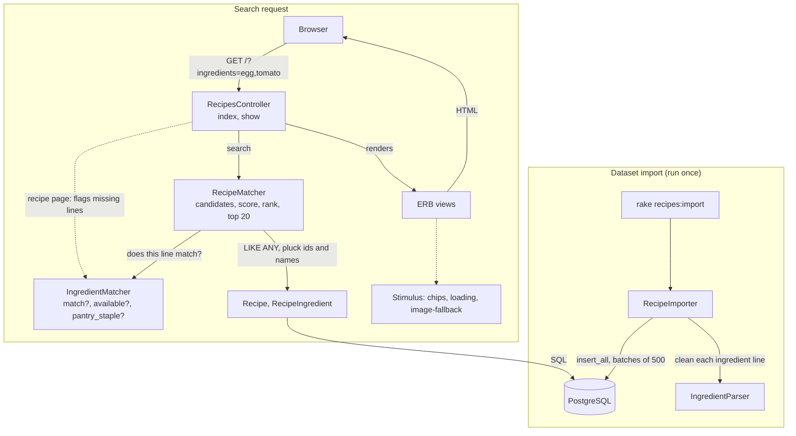
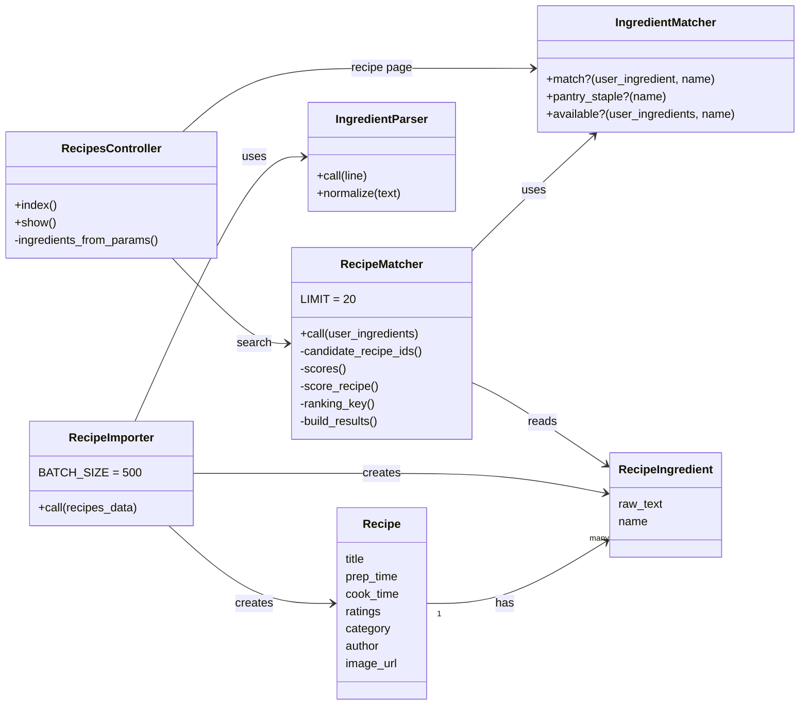
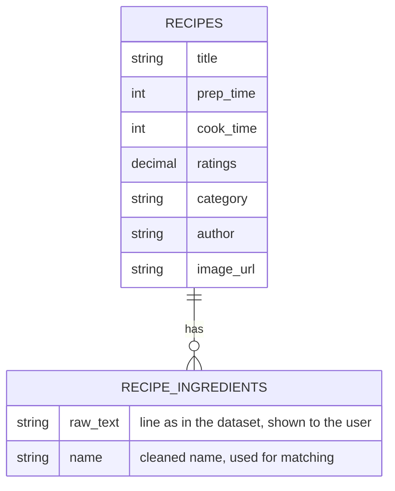

<p align="center">
  
</p>

<h1 align="center">It's dinner time!</h1>

<p align="center">
  <em>What can I cook with the ingredients I have at home?</em><br>
  Type your ingredients and get the best matching recipes first, with what you already have and what is missing.
</p>

<p align="center">
  <a href="https://recipes.ariadnamartin.dev"><b>Open the live app</b></a>
</p>

<p align="center">
  
  
  
  
  
</p>

> [!NOTE]
> The app runs on Render's free plan: after a period without visits it falls asleep, so the **first request can take about a minute**.

| | |
|---|---|
| **Stack** | Ruby 3.4 · Rails 8.1 · PostgreSQL · server-rendered HTML · a little JavaScript (Stimulus) |
| **Data** | 10,013 allrecipes.com recipes from the assignment's dataset |
| **Search** | In the URL (`/?ingredients=egg,tomato`), so results can be shared and the back button works |

## Contents

1. [User stories](#user-stories)
2. [How it works](#how-it-works)
3. [Architecture](#architecture)
4. [Product decisions](#product-decisions)
5. [Run it locally](#run-it-locally)
6. [Deployment](#deployment)
7. [How I used AI](#how-i-used-ai)
8. [An incident worth telling](#an-incident-worth-telling-running-out-of-memory-in-production)
9. [Known limitations](#known-limitations)
10. [Next steps](#next-steps)

## User stories

### 1. Find recipes with the ingredients I have

**As a** user, **I want** to fill in the ingredients I have at home **so that** I can see which recipes I can make with them.

**Acceptance criteria**

- I can type more than one ingredient before searching.
- A short list of pantry staples (salt, black pepper, water, cooking oil) is assumed available and shown on the page.
- Ingredients match regardless of case or plural (`Eggs` finds `1 egg`).
- A different product made from an ingredient does not count (`chicken` does not cover `chicken broth`).
- If there is no match, I see a message.

### 2. See the best options first

**As a** user, **I want** the recipes with the fewest missing ingredients to appear first **so that** it is easy to choose what to cook.

**Acceptance criteria**

- Only recipes that use at least one of my ingredients are shown.
- Recipes with the fewest missing ingredients appear first; ties are broken by how many of my ingredients they use, then by rating.
- Each result shows how many ingredients I have and lists the ones I am missing.

### 3. Recipe preview

**As a** user, **I want** to open the recipe to know all the ingredients and recipe details (time, rating, …) **so that** I can decide before starting it.

**Acceptance criteria**

- The recipe preview shows basic info such as title, preparation and cook time, and the full ingredient list.
- It is easy to identify missing ingredients.
- I can go back to results without retyping the ingredients.

## How it works



The classes and what they depend on:



| Piece | What it does |
|---|---|
| `IngredientParser` | Turns a dataset line like `2 skinless chicken breasts, diced` into a clean name (`chicken breast`) used for matching. The original line is kept to display it. |
| `RecipeImporter` | Loads the dataset into two tables: `recipes` and `recipe_ingredients` (one row per ingredient line). |
| `IngredientMatcher` | Decides if a user ingredient matches an ingredient line, and which lines are pantry staples. |
| `RecipeMatcher` | Finds candidate recipes, scores them and returns the top 20 with their matched and missing ingredients. |
| `RecipesController` + views | A search page (`/`) and a recipe page (`/recipes/:id`). The search lives in the URL, so results can be shared and the back button works. |
| Stimulus controllers | Ingredient "chips" (add with Enter, comma or +; Clear all), a "Searching…" state, and a fallback for broken images. The pages still work without JavaScript. |

## Architecture

### Data model



Two tables. Each ingredient line is stored twice on purpose: `raw_text` is shown as it came in the dataset, and `name` is the cleaned and normalized version the search compares against. Both `name` and `recipe_id` are indexed.

### Design choices

- **Classic Rails layers.** Controller for the request, views for the HTML, and plain Ruby "service objects" (`app/services`) for the business rules. The rules do not depend on the web layer, so they are easy to test and to explain.
- **Server-rendered HTML.** The assignment asks for a simple UI; there is no JavaScript framework or API. Stimulus only adds small touches on top, and the pages work without it.
- **Search state in the URL.** `GET /?ingredients=egg,tomato` makes results shareable and keeps the back button working, with no session or stored state.
- **Matching in Ruby, filtering in the database.** PostgreSQL narrows the candidate recipes with a query on the indexed `name` column; Ruby then applies the matching and ranking rules, which are easier to read and test there than in SQL.
- **Dataset loaded once, not on every request.** A rake task imports it in batches, so the app only reads from its own database.

## Product decisions

The rules that decide what a good result is are written down as short ADRs (what we chose, what else we considered, and the consequences), with a [glossary](docs/glossary.md) of the terms:

1. [Ingredient matching](docs/adr/0001-ingredient-matching.md): an ingredient matches when the line uses it, not a product made from it.
2. [Derived product words](docs/adr/0002-derived-product-words.md): `chicken` does not match `chicken broth`.
3. [Pantry staples](docs/adr/0003-pantry-staples.md): salt, black pepper, water and cooking oil are assumed available (exact names only).
4. [Ranking](docs/adr/0004-ranking.md): fewest missing ingredients, then most of your ingredients used, then rating; top 20.
5. [Case and plurals](docs/adr/0005-normalize-case-and-plurals.md): `Eggs` finds `1 egg`.
6. [Varieties](docs/adr/0006-varieties-known-limitation.md): `cheese` covers `cheddar cheese`.

## Run it locally

You need Ruby 3.4 (see `.ruby-version`) and PostgreSQL running.

```sh
bundle install
bin/rails db:setup          # creates and migrates the database
bin/rails recipes:import    # downloads the dataset and loads it (takes a minute)
bin/rails server            # http://localhost:3000
```

Tests and style checks:

```sh
bundle exec rspec
bin/rubocop
```

### Quality checks and dependency updates

`bin/ci` runs the style check (RuboCop) and the security checks (Brakeman for the code, `bundler-audit` and `importmap audit` for the dependencies). Together with `bundle exec rspec` for the tests, that is what I run before each pull request.

GitHub's automatic checks are switched off (the organization has no Actions minutes), so the workflow in `.github/workflows/ci.yml` only runs on demand.

[Dependabot](.github/dependabot.yml) is enabled: every week it opens pull requests to update the Ruby gems and the GitHub Actions versions. I review each one and merge it once the tests pass.

## Deployment

The app runs on [Render](https://render.com) on the free plan, at https://recipes.ariadnamartin.dev. The infrastructure is described in `render.yaml`:

| Piece | Detail |
|---|---|
| **Web service** | Ruby runtime, started with `bundle exec puma`. Render checks `/up` as the health check. |
| **Database** | A free Render PostgreSQL instance, connected to the app through the `DATABASE_URL` variable. |
| **Build** | `bin/render-build.sh` installs the gems, compiles the assets and runs the migrations (`db:prepare`). |
| **Secrets** | `RAILS_MASTER_KEY` is set by hand in Render's dashboard and is not in the repository. |
| **Memory** | The free plan has 512 MB, so `WEB_CONCURRENCY` is 1 (one Puma process). See the incident below. |
| **Domain** | A custom subdomain of my own domain, pointing at the Render service. |

**How a change reaches production:** every change is a small branch and pull request. When I merge it into `main`, Render builds and deploys it by itself. I then check the deploy in Render's *Events* and *Logs* and try the live page.

**Loading the data:** the dataset is not loaded during the build. It is imported once by hand, from my machine, against the database's external URL (kept out of the repository and never shared):

```sh
DATABASE_URL="<external database URL from Render>" bin/rails recipes:import
```

I chose to keep it manual for now because it only has to happen once; automating it is in the next steps.

**Things I learned about the free plan:** the app falls asleep after a while without visits, so the first request takes about a minute; and the 512 MB memory limit is real, as the incident below shows.

## How I used AI

I do not have Ruby experience, so I worked with **Claude (Anthropic) through Claude Code**. The split was:

- **I decided** what to build and how it should behave: the user stories, the matching and ranking rules (the ADRs), what is out of scope, the UX changes, and what to leave as known limitations.
- **Claude implemented** the code, tests and docs under my direction, in small steps: one branch and pull request per change.
- **I reviewed and validated** each change: I read the explanations of the code, ran `bundle exec rspec` and `bin/rubocop` on my machine, tried the app in the browser and on a phone, and checked the production deployment.

> [!IMPORTANT]
> AI was a supportive tool, not a replacement for my own judgement: every rule in the ADRs is a decision I made and can explain.

### What Claude did for me

Because I do not know Ruby, Claude was most useful for everything that depends on knowing the language and the framework: the **Ruby and Rails syntax**, the **project skeleton** (models, migrations, controller, views, the rake task, the RSpec setup and the Render configuration) and the first version of each service. I could explain what each piece was for, but I could not have written it quickly myself.

### What I did

- **Product and design decisions.** I chose the matching and ranking rules and wrote the reasons down as ADRs (for example, a derived product such as `chicken broth` does not count as `chicken`, and only exact names count as pantry staples). When a rule added complexity I could not explain, I asked to simplify it: I asked to remove the custom plural rules so the model stayed explainable.
- **Scope.** I decided what not to do: no automatic import on deploy, no special case for a bare `pepper`, no scraping for the cooking steps. These are recorded as known limitations and next steps.
- **Testing the product, not only the code.** I found most of the real problems by using the app: images that did not load (HTTP 400), a layout that left empty space on wide screens, a result order that put a one-ingredient recipe above a better one for `tomato, egg`, an ingredient line such as `salt and pepper` shown as missing, and whether the Enter key was understood on a phone. Each one became a change, a decision or a documented limitation.
- **UX.** I asked for the quick wins: a "Searching…" state, matched ingredients, time and rating on the cards, example searches, a + button, a loading message and a "Clear all" button. I also picked the logo.
- **Running and reviewing.** I ran the tests and style checks on my machine, made the commits, and opened and merged each pull request. I read the code and decided whether to remove rules or add more.
- **Production.** I created and checked the deployment, ran the dataset import against the production database, and diagnosed the memory crash from Render's events and logs (see below).

### Where I used it and how I validated it

| Task | How I validated it |
|---|---|
| Rails scaffolding, data model, dataset import | Ran the import locally and in production; counted rows and inspected samples. |
| Ingredient parser, matcher and ranking | Specs with fixture recipes for each rule in the ADRs; manual searches such as `tomato, egg`. |
| UI, styling and Stimulus controllers | Used it in the browser and on a phone; request specs for the rendered pages. |
| Debugging the production memory crash | Read the Render logs and events myself, reviewed the fix and watched it deploy. |
| Docs (ADRs, glossary, this README) | Read and corrected them; the decisions in them are mine. |

## An incident worth telling: running out of memory in production

<details>
<summary><b>What happened and how we fixed it</b></summary>

After one deploy the site looked broken. In Render's events I found *"Instance failed: ran out of memory (used over 512MB)"*. The free plan has 512 MB; the app ran two Puma processes, and a search for a very common ingredient (`chicken`) loaded thousands of recipes with all their lines as Rails objects.

Two fixes, each in its own PR: run **one** Puma process, and make `RecipeMatcher` score using only ids and names and load full records just for the 20 winners. Same results and order, same tests. The lesson: test with very common ingredients and watch memory, not only speed.

</details>

## Known limitations

> [!WARNING]
> **No cooking steps.** The dataset has 9 fields per recipe (title, times, ingredients, rating, cuisine, category, author, image) and no steps or original URL, so the app only shows ingredients.

Other limitations:

- **Ingredient parsing is approximate.** For example `salt and pepper` counts `pepper` as missing, Rails singularizes a few words oddly (`cloves`), and `2% milk` keeps its `%`.
- **Varieties.** A generic ingredient covers its varieties (`cheese` covers `cheddar cheese`), but it also matches some different products: `butter` matches `peanut butter` and `milk` matches `coconut milk`.
- **Result order.** With several ingredients, a recipe that uses only one of them but misses nothing can appear before one that uses both and misses one.
- **Free plan.** The first request after a sleep takes about a minute; warm searches take roughly 0.4 to 1.3 seconds.

## Next steps

- Load the dataset automatically on deploy, only when the `recipes` table is empty.
- Make search faster: work with names instead of full records, or precompute.
- Improve the result order: prioritize recipes that use more of your ingredients, or split results into "use all your ingredients" and "use some".
- **Monitoring.** Today I only see problems by reading Render's logs and events by hand, which is how I found the memory crash. Next: error tracking (so exceptions reach me), an uptime check on `/up`, and alerts on memory and response time, so I hear about a problem before a user does.
- Handle common combined staples (`salt and pepper`) and singularization oddities.
- Show cooking steps, which needs a richer dataset (for example scraping with `recipe-scrapers`).
- Small UX ideas: shorter *Missing* list, ingredient suggestions as you type, and a "show more" beyond the first 20 results.
